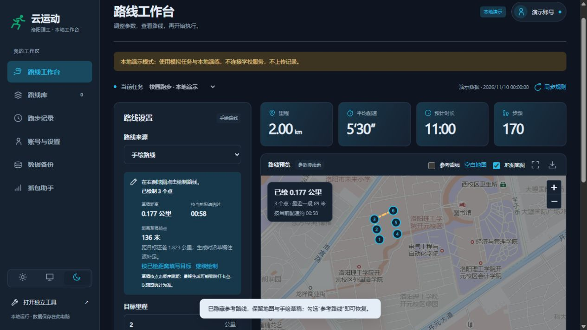

# 云运动 · 洛阳理工本地工作台

**版本：1.0.0 · Windows 64 位 · 单账号**

在本机浏览器里完成登录、路线生成、手绘、预览、演练、执行和跑步记录查询。提供单文件 EXE，以及附完整源码、内置 Python 的免安装 ZIP；前端没有编译步骤。

本项目由 **SpringSoap / seedsky** 维护，基于已有洛阳理工 2.1.1 修改版及 [Zirconium233/yunForNewVersion 的 develop 分支](https://github.com/Zirconium233/yunForNewVersion/tree/develop)。保留上游协议与执行引擎，新增工作台及 Windows 便携体验。来源和许可边界见 [NOTICE.md](NOTICE.md)。

## 选择运行方式

| 版本 | 如何启动 | 数据放在哪里 |
|---|---|---|
| `yunRun-LYLG-v1.0.0.exe` | 双击即可，不需要另装 Python | EXE 同级的 `云运动用户数据/` |
| `yunRun-LYLG-v1.0.0-内置环境.zip` | 完整解压，打开 `启动入口/启动联网面板.bat` | 解压目录顶层的 `用户数据/` |
| GitHub 源码 | 安装依赖后运行 `python web.py` | 源码目录的 `data/` |

GitHub 的 **Code → Download ZIP 是源码压缩包**，不包含内置 Python。不要把它与免安装发行包混淆。EXE 首次启动需要解压内置资源，稍等片刻；不需要管理员权限，也不要求安装手机驱动后才能使用普通功能。

关闭网页后任务仍在本机后台运行，重新打开面板可继续查看；**关闭控制台才是退出程序**。默认地址 `http://127.0.0.1:8090`，端口被占用时自动顺延，以控制台显示地址为准。

## 登录：先看是否需要保留手机会话

| 登录方式 | Token 如何获得 | 对手机登录状态的影响 |
|---|---|---|
| **抓包登录** | 复用手机当前已登录会话的 token | **抓包登录本身不顶号，不影响手机当前登录状态** |
| **账号密码登录** | 电脑向学校服务申请新 token | **会顶号，手机原会话可能失效，需要重新登录** |
| 已有有效 token | 直接复用，不重复登录 | 不主动创建新会话 |

以上顶号情况已在本次学校环境中实测。手机再次重新登录，也会使电脑之前的独立 token 失效。**两种入口并存，不等于服务器允许两个独立新 token 永久同时有效。**

账号密码登录使用官方 App 的学号与密码，成功后 token 和密码通过当前 Windows 用户的 DPAPI 加密保存。有效 token 优先；明确失效时，若已保存密码，会尝试自动密码登录一次，失败就停止。**自动密码重登同样会顶号**；希望保留手机当前会话时，优先重新抓包共享手机 token。

抓包获得的候选 token 先隔离加密，读取服务器资料核实学校和学号、验证任务后才启用。同一账号保留已保存密码；换号不继承旧密码；验证失败保留原有会话。账号页只显示是否已保存及登录来源，不回显 token 或密码。

“退出并清除凭据”清除本机密码和 token，保留账号名、设置与路线。删除加密文件后也需重新登录。

## 抓包登录教程

推荐使用本次实测成功的 **手机 USB 网络共享 + Super Proxy + 电脑代理**。不必开启 USB 调试才能按面板操作；USB 调试端口转发只是开发排查的另一条路径。

1. 在手机保持云运动已登录。USB 接电脑，开启手机的 **USB 网络共享**；电脑出现 USB/RNDIS 网络适配器后，打开工作台的“抓包助手”。
2. 选择电脑 USB 网卡对应的 IPv4 地址，用手机打开面板显示的连接测试页。页面显示已连接，再进行下一步。不要照抄教程里的旧 IP；手机热点、校园网等方式是否互通，以测试页为准。
3. 点击“启动抓包代理”。手机安装 [Super Proxy](https://superproxy.cc/)；在软件中新建配置，协议选 **SOCKS5**，服务器填写刚才的电脑地址，端口填写面板显示的 SOCKS5 端口，验证方式为“无”。不要把 SOCKS5 端口填到系统 HTTP 代理位置。
4. 如果手机尚未信任当前抓包环境的 CA，从面板的手机页下载当前证书，再通过手机系统的 **安装 CA 证书** 入口安装。已安装且与电脑环境匹配时不必重复安装；换环境后旧证书不能代替新证书。本项目不分发原环境证书或 CA 私钥。
5. 启动手机代理，打开云运动，进入首页或已有记录页以产生请求。无需为了抓包反复注销、重新登录，更不需要开始跑步。
6. 捕获成功后电脑会停止代理。**先关闭手机 Super Proxy**，再在面板点击“验证登录状态并进入工作台”。验证通过后使用的就是手机当前 token，不会额外发起账号密码登录。

本次已实测 USB 网络共享、SOCKS5、匹配既有 CA 的 HTTPS 解密、token 捕获、同账号保留密码与电脑/手机同时查询。系统 Wi-Fi HTTP 代理不是这次已验收的默认方案。更多说明见 [docs/CAPTURE.md](docs/CAPTURE.md)。

公开源码仓库不收录第三方 APK。维护者本机制作的便携包按既有要求附带用户提供的安装包；未修改软件，不改变其原有授权。

## 路线、手绘与执行

1. 登录后自动读取任务规则。只有一个任务时自动选中，多个时明确选择；页面显示来源和更新时间。未下发的字段显示“未确认”，本地上限明确标为“本地配置”。
2. 在统一的“路线来源”里选择随机生成、已有路线、历史记录或手绘。常用项直接显示，高级项折叠；默认填写目标平均配速，分和秒分开输入，沿途配速默认起伏。
3. 手绘直接点击地图加点，也可点击打卡点定位。左侧与地图浮层实时显示累计距离、点数、最近一段、按当前配速估时及距起点距离；撤销、清空同步更新，完成绘制仍保留草稿。
4. 草稿长度与目标里程分开显示。草稿较短时生成器沿草稿往返补足，较长时按目标截取；也可主动点击“按已绘距离填写目标”。草稿统计不代替最终预览，吸附点位和采样后以预览为准。
5. “生成并预览”应用参数并生成临时快照；“仅预览”读取原路线，不重新随机生成、不改原文件。**临时预览不必先保存就能执行**，“保存路线”只是收藏。
6. 改参数后保留旧图，但标记过期并暂停执行，重新生成后恢复。手绘使用橙色虚线，预览使用绿/青色实线；“参考路线”和“空白地图”仅控制显示，不删除草稿或路线。
7. 本地演练可选，使用假传输并禁止网络连接。正式执行前重新获取服务器规则并校验当前快照；失败保留输入并给出建议，不擅自改目标值。
8. 默认按路线时长执行，执行期间锁定参数；停止前有简短确认。程序中断后不自动续跑，保留最后确认的进度与日志。



地图组件随包；联网时加载高德底图，关闭底图或断网仍可看路线和绘制。坐标采用 **GCJ-02**，不自动转换 WGS84。几何校验不代表能够判断道路通行、建筑物或现实安全情况。

## 结果、日志与跑步记录

- 执行结果区分“结束请求已受理”和服务器成绩判定，保留业务码及脱敏说明；已受理不等于最终达标。
- 日志按信息、成功、注意、错误分色。
- “跑步记录”按学期查询已有记录，可按成绩筛选，详情显示开始时间、服务器结束时间、里程、用时、配速、步频及具体原因。
- `isQualified=1` 表示有效/达标，`2` 表示无效/不达标。其他未知码保留原值。
- 不达标原因直接显示服务器 `noQualifiedReason`，不把 `remake` 备注编码猜成原因。列表的零用时、零配速显示“待详情确认”。
- 开始时间、结束时间、用时分别按服务器字段显示，不用时间差擅自重算 duration。查询记录只读，不创建或上传跑步记录。

使用者表示已自行测试真实提交流程；维护者本次 EXE 与自动回归验收仍只做本地模拟及只读检查，不重复新建线上记录。

## 独立工具与主题

便携包双击 `启动入口/启动独立工具.bat`；EXE 运行 `yunRun-LYLG-v1.0.0.exe --mode offline`，或从面板左下角切换。独立工具不要求账号，不连接学校服务；路线生成、手绘、预览、保存、导入导出与本地演练仍保留。

提供亮色、暗色、跟随 Windows 三种选择，记住手动选择。账号、主题及底层兼容参数均有中文说明；底层配置位于高级设置。

## 备份、升级与数据目录

在“数据备份”导出 JSON，无需备份密码。包含账号/token、设备字段、偏好及本地路线，**不含登录密码、程序、Python、日志和 CA 私钥**。导入可分别选择账号、设置、路线；同名默认保留两份并改名，可手动覆盖或跳过。

同一 Windows 用户升级时：先关闭旧控制台，将旧版 `data/` 或 `用户数据/` 内容复制到新 ZIP 的 `用户数据/`；EXE 则复制到其同级 `云运动用户数据/`。先备份，不要用旧数据覆盖新产生的内容。跨电脑或 Windows 用户使用面板导出/导入；token 失效后重新登录，DPAPI 文件不能直接跨用户解密。

发行包与公开仓库不含个人凭据。分享源码用构建脚本生成的白名单 ZIP，不要把正在使用的整个数据目录压缩上传。

## 相对原版 develop 的主要改动

| 范围 | 本版改动 |
|---|---|
| 学校适配 | 默认洛阳理工参数，动态读取任务、范围和打卡点，来源与缓存明确显示 |
| 网页结构 | 从 Python 内嵌页面拆为 HTML/CSS/JavaScript，双主题、同屏工作台，无前端构建步骤 |
| 登录机制 | 复用上游已有密码登录协议，增加 Windows 用户级加密、token 复用、失败停止及抓包会话身份核实 |
| 路线操作 | 统一四种来源和公共地图，合并“生成并预览”，保留仅预览与不保存执行 |
| 手绘 | 地图内直接绘制、实时统计、草稿保留、参考路线显隐和独立配色 |
| 预览一致性 | 执行锁定预览快照与摘要，避免随机换表或再次生成；改参数明确使预览过期 |
| 配速与规则 | 目标平均配速分秒输入、默认沿途起伏，保留输入并明确报告规则冲突 |
| 任务生命周期 | 后台执行、日志分级、结果卡片、停止确认、控制台关闭带走子进程、中断不续跑 |
| 记录查询 | 在上游历史能力上增加中文列表、筛选与详情，直接呈现服务器不达标原因 |
| 数据管理 | 无密码的选择性备份、重名保留两份、独立数据目录和干净发行白名单 |
| 交付与维护 | 单文件 EXE、内置 Python ZIP、独立工具入口、中文模块说明及离线回归 |

协议、兼容执行、人脸与几何模块来自上游及用户既有版本，不宣称这些能力均为本项目原创；未针对学校成绩判定作保证。

## 源码运行与测试

建议 Python 3.12。普通使用无需 Node；Node 仅运行草稿几何开发测试。

```powershell
python -m venv .venv
.\.venv\Scripts\python.exe -m pip install -r requirements.txt
.\.venv\Scripts\python.exe -X utf8 web.py
.\.venv\Scripts\python.exe -X utf8 web.py --demo --no-browser
.\.venv\Scripts\python.exe -X utf8 -m unittest discover -s tests -v
node --test tests/test_drawing.mjs
```

`--demo` 使用隔离目录和模拟任务，禁止学校请求与正式上传。修改前先读 [AGENTS.md](AGENTS.md)、[代码结构](docs/ARCHITECTURE.md) 和 [产品决策](docs/DECISIONS.md)。模块职责、关键输入输出和不可破坏的约束都有中文说明。

## 自行构建单文件 EXE

在 Windows 的 Python 3.12 环境运行：

```powershell
python -m venv .venv-build
.\.venv-build\Scripts\python.exe -m pip install -r requirements.txt -r requirements-build.txt
.\.venv-build\Scripts\python.exe -X utf8 build_exe.py
```

产物为 `distribution/exe/yunRun-LYLG-v1.0.0.exe`，旁边有大小与 SHA-256 清单。保留控制台，符合关闭控制台即退出的设计。资源在 EXE 内，用户数据在 EXE 旁，不会写进临时解压目录；演练和抓包子进程复用同一程序入口。

构建采用明确资源清单，不收录本机凭据、CA、抓包文件或开发报告。PyInstaller 参数及资源路径机制见 [官方使用说明](https://pyinstaller.org/en/stable/usage.html) 与 [运行时路径说明](https://pyinstaller.org/en/stable/runtime-information.html)。

## 自行构建内置环境 ZIP

在免安装包的 `程序文件/` 中运行：

```powershell
.\runtime\python.exe -X utf8 build_release.py
```

公开 Git 仓库不提交 Python 环境；若从 Git 克隆构建此 ZIP，先将已有干净免安装包的 `程序文件/runtime/` 复制到源码根目录，或准备同结构的完整可移植 Python 3.12 环境。脚本会检查运行环境存在及账号配置为空，输出到 `distribution/`。ZIP 顶层保持“启动入口、程序文件、使用说明”，首次运行创建“用户数据”。

## 验收与许可

详细验证范围见 [docs/VALIDATION.md](docs/VALIDATION.md)，手机实测见 [docs/PHONE_VALIDATION.md](docs/PHONE_VALIDATION.md)。跨电脑实机迁移按当前计划暂缓；不把某一机型的 USB 成功推定为所有校园网络都可用。

保留仓库创建时的 **MIT License，Copyright (c) 2026 SpringSoap**，见 [LICENSE](LICENSE)。MIT 在本项目中适用于本次原创新增部分；上游原文件、用户既有模块及第三方资源的范围单独列于 [NOTICE.md](NOTICE.md)。本次核对的上游提交未提供明确的整体许可证，不将其擅自改授 MIT，也不以本仓库许可证覆盖 APK、地图或第三方库。
